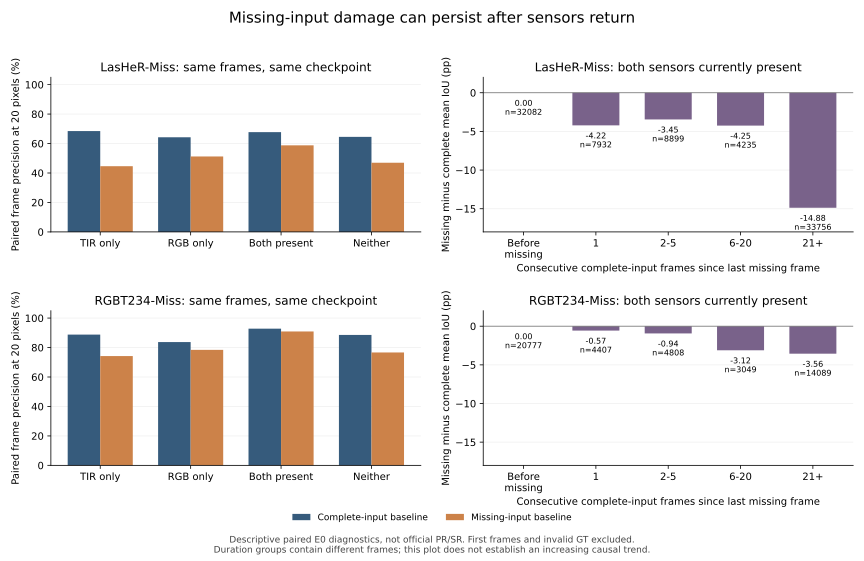

# E0 完整与缺失输入的同帧配对诊断

本报告使用已完成的479序列337353帧原始预测，无新增NN。权重、每份bbox/收据、713份GT及两个mask的SHA核对通过。初始化后、首次真实缺失前共53027帧，两次预测bbox最大差为0，支持两个入口在相同输入历史时一致。

以下均为**同帧配对、连续坐标、按帧加权的描述指标**，不是官方按序列汇总PR/SR。排除初始化帧及任一模态GT中有非正坐标的帧：LasHeR其余1259帧，RGBT234其余688帧；官方主表仍按原协议计全部帧。

| 数据集 | 当前可用模态 | 配对帧数 | 完整轨迹精度20px | 缺失轨迹精度20px | 缺失−完整差/pp | 均值IoU差/pp |
|---|---|---:|---:|---:|---:|---:|
| LasHeR | 仅TIR | 55534 | 68.4896 | 44.6177 | -23.8719 | -19.1688 |
| LasHeR | 仅RGB | 43233 | 64.2403 | 51.2086 | -13.0317 | -9.6237 |
| LasHeR | 两者可用 | 86904 | 67.7449 | 58.7637 | -8.9812 | -6.7251 |
| RGBT234 | 仅TIR | 24428 | 88.7752 | 74.2017 | -14.5734 | -16.4759 |
| RGBT234 | 仅RGB | 25434 | 83.7304 | 78.4344 | -5.2961 | -5.2560 |
| RGBT234 | 两者可用 | 47130 | 92.7944 | 90.9315 | -1.8629 | -1.4137 |

相比旧按可用状态直接分组，这里每个缺失预测都有同一帧、同一目标的完整输入对照，避免将两组帧本身的难度差全部误认作模态损失。不同可用状态仍有不同历史，因此“RGB比TIR更主导”的因果判断还需在train/val上对同一帧分别删RGB/TIR。

## 已确认的问题与尚未定位的原因

首次缺失前精度/IoU配对差为0；在经历过缺失后，当前两模态恢复的帧仍存在性能缺口。缺失造成的影响不只发生在当前被mask的位置，也可能沿过去的预测状态传播。

原始跟踪器用上一预测框裁剪下一搜索区域（`lib/test/tracker/cadtrack.py:83`），并在自身响应够高时用预测框更新模板（:116）。这两条路径都能携带历史误差；本次仅有最终bbox，没有模板更新时间/响应/裁剪完整日志，**不能把缺口唯一归因于模板污染，或声称模板干预已证明有效**。

当前新tracker已保留模板可用标识（`miss_rgbt/tracker.py:57`）；局部补偿可以作用于历史模板中仍缺失的token。它是否解决上述缺口，必须由E4相对E3的最终配对结果证明，不能从代码存在推出效果。

排除首次缺失前的相同前缀后，真正“经历缺失、当前又完整”的54822个LasHeR帧，配对精度差为-14.2370pp；RGBT234对应26353帧为-3.3317pp。该子组也只用于诊断，不能拿它替代官方全量成绩。

根据原生 `sample_target` 的4倍搜索框公式，从上一预测框离线推导当前裁剪区域：上述恢复帧中，LasHeR有6035帧（11.0084%）完整轨迹的搜索区域包含GT中心，而缺失轨迹不包含；其中5536帧（10.0981%）缺失轨迹的区域与GT框完全无交集、完整轨迹仍有交集。RGBT234对应768帧（2.9143%）和684帧（2.5955%）。这提供了**搜索区域偏移的直接几何证据**，说明局部token补偿不能预先假定当前crop仍包含目标。

该计算不读取图像，几何交集不保证目标外观可见；没有用GT重新定位模型，也没有证明更换crop能挽回多少正式指标。双缺失保持帧未运行搜索，未计入这个crop诊断。原始计数见[search_support.json](search_support.json)，代码见[几何计算](../../analysis/analyze_search_support.py)。

恢复后连续21+帧组的差距更大，但各时长组不是同一批帧，不能称“恢复时间越长，损害必然越严重”。双缺失状态使用上一框保持，不把该组成绩称作网络修复。

## 反馈假设的证据边界

原始缺失轨迹也存在完整轨迹错、缺失轨迹对的帧，例如LasHeR仅TIR组2816帧、RGBT234仅TIR组663帧。这支持“信息较少的视图并非每帧都更差”，不证明**经过训练的M**已经学到能改善C的判别知识，更不证明向C反馈后一定有收益。当前E3/E4的reverse_weight仍为0。

三个研究组件仍需独立消融：任务依据的局部补偿；完整→缺失的响应指导；保留完整任务能力的可靠缺失→完整反馈。后续先在train/val的同帧扰动中检查目标—背景响应、裁剪偏移和模板更新，再冻结新机制。当前Test诊断不用于调整已冻结的E3/E4配置、选择轮次或反馈阈值。

原始数值及1675项输入哈希见[paired_diagnostics.json](paired_diagnostics.json)，479条序列配对结果见[sequence_deltas.csv](sequence_deltas.csv)。源码见[离线计算](../../analysis/analyze_paired_baseline.py)与[绘图](../../analysis/plot_paired_baseline.py)。

首运行误用新评估入口的bbox_sha256键，旧E0收据实际字段为result_sha256，CPU检查退出1、未生成成绩；改用实际字段后重新完整运行退出0。没有添加兼容fallback、改预测或重跑NN。
